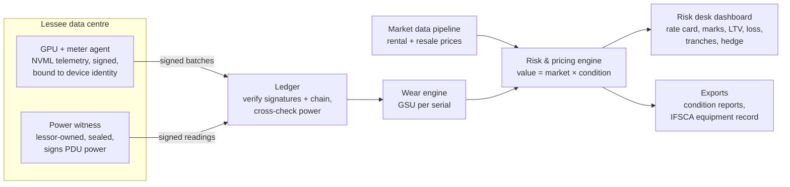

# Chirayu: Implementation Plan

**Chirayu** (चिरायु, "long-lived") is a pricing, risk and financing desk for GPU operating leases written out of GIFT IFSC. It prices leases, marks every leased GPU each month, simulates lease-end losses, hedges market risk and sizes funding tranches. All of this rests on per-GPU condition data that the lessee cannot quietly edit.

This document is the build plan for the GIFT FutureLab Grand Challenge 2026–27 finale (22 Dec 2026, IIT Gandhinagar). It covers what we build, how each part works, who builds it, and in what order.

---

## 0. Key dates

| Date | Event | What must exist |
| --- | --- | --- |
| 25 Nov 2026 | First shortlist | Application submitted |
| 30 Nov 2026 | First mentoring interaction | M0 done: meter v0 on a real GPU, GSU v0, rate card v0, open questions list (§12) |
| 4 Dec 2026 | Final shortlist | M1 in progress: ledger, witness prototype, Monte Carlo v1 |
| 19 Dec 2026 | Feature freeze | M3 done; only bug fixes after this |
| 20–21 Dec 2026 | Rehearsals | Two timed full runs; backup video of every live moment |
| 22 Dec 2026 | Grand Finale | Four live demo moments (§10) |

---

## 1. Scope

### 1.1 Finale deliverables

1. **Risk desk dashboard**, covering a synthetic book of 500 GPU leases across three Indian AI-cloud lessees. It shows marks, LTV, expected loss, tail loss, tranche sizing and hedge ratio.
2. **Live lease pricer:** the same GPU-hours run under two operating profiles give two different rents. A flat worst-case lease is shown beside them for comparison.
3. **Value-of-data analysis:** senior tranche size and funding saving (bps) with versus without condition data.
4. **Trust layer on a real GPU:**
   - a signed, hash-chained telemetry stream;
   - an independent power witness;
   - a live tamper detection: spoof the agent, the alert fires and the mark updates.
5. **Wear model** (GPU Stress Unit, GSU) with documented parameters, sensitivity bands and a calibration notebook on the ORNL Titan GPU-lifetime dataset.
6. **Market data pipeline:** daily scrape of public GPU rental prices, forming an India rental curve and its basis against public US index points.

### 1.2 Non-goals for the finale

- Real lessor data or real leases. The book is synthetic, and we say so.
- Production security hardening: HSMs, key rotation, multi-tenant auth.
- Remote kill switches or any control over the GPU. Chirayu is read-only.
- Retail investment advice of any kind.
- A regulatory filing. We only identify the likely route (IFSCA TechFin / Ancillary Services) and ask mentors.

---

## 2. Architecture



**Data flow in one sentence:** every second the agent and the witness each sign a reading. The ledger verifies them and flags divergence. The wear engine turns verified readings into stress units per GPU per month. The risk engine combines stress units with market data to produce every financial number on the dashboard.

---

## 3. Repository layout

```
chirayu/
├── IMPLEMENTATION PLAN.md
├── README.md
├── pyproject.toml              # uv / pip, Python 3.11+
├── configs/
│   ├── wear_params.yaml        # Ea, n, m, weights, reference conditions, ranges
│   ├── risk_params.yaml        # yields, rho, regime model, tranche targets
│   └── lessees.yaml            # synthetic lessee profiles
├── agent/                      # meter agent (runs on the GPU host)
│   ├── sampler.py              # NVML sampling loop
│   ├── chain.py                # hash chain + ed25519 signing
│   ├── attest.py               # NVIDIA attestation binding (optional)
│   ├── uploader.py             # batching, offline buffer, retry
│   └── spoof.py                # demo-only: tampered agent for the live catch
├── witness/
│   ├── firmware/               # ESP32 (PlatformIO) firmware
│   ├── bridge/                 # Pi/laptop bridge for smart-plug fallback
│   └── HARDWARE.md             # BOM, wiring, safety
├── ledger/                     # FastAPI service + Postgres
│   ├── app.py
│   ├── models.py               # SQLAlchemy tables
│   ├── verify.py               # signature, chain, nonce checks
│   ├── divergence.py           # witness cross-check (regression + CUSUM)
│   └── merkle.py               # hourly Merkle roots
├── wear/
│   ├── gsu.py                  # GSU computation
│   ├── rainflow_cycles.py      # thermal cycle extraction
│   ├── calibrate_titan.ipynb   # Cox model on ORNL Titan data
│   └── sensitivity.py
├── market/
│   ├── scrapers/               # one module per provider
│   ├── normalize.py            # USD/GPU-hr, SKU, term
│   ├── index.py                # India rental curve + basis
│   └── store.py                # DuckDB / Parquet
├── risk/
│   ├── residual.py             # M(a,s), C(g), p_f(g)
│   ├── pricing.py              # base rent solve, indexed variant
│   ├── reserves.py             # wear reserve rate
│   ├── montecarlo.py           # portfolio loss simulation
│   ├── tranching.py            # attachment points, value of data
│   ├── hedge.py                # min-variance hedge ratio, basis
│   ├── insurance.py            # RV insurance premium
│   ├── optimizer.py            # lessee power-cap optimizer
│   └── book.py                 # synthetic lease book generator
├── api/                        # FastAPI read API for the dashboard
├── web/                        # React + Vite dashboard
├── notebooks/                  # exploration, figures for slides
├── tests/
└── .github/workflows/
    ├── ci.yml                  # lint + tests
    └── scrape.yml              # daily market scrape (cron)
```

---

## 4. Tech stack

| Layer | Choice | Why |
| --- | --- | --- |
| Language | Python 3.11+ for everything except firmware and web | One language across agent, ledger, models |
| GPU telemetry | `nvidia-ml-py` (pynvml); DCGM optional | Direct NVML access, no daemon needed |
| Crypto | `pynacl` (Ed25519), SHA-256 | Small, well-reviewed, fast |
| Attestation | NVIDIA Attestation SDK / nvTrust on a confidential-computing-capable H100 | Binds logs to a device identity; optional, with a documented fallback |
| Ledger | FastAPI + SQLAlchemy + Postgres (SQLite in dev) | Fast to build, typed |
| Wear model | NumPy, `rainflow`, `lifelines` (Cox PH) | Standard reliability tooling |
| Risk engine | NumPy (vectorised), SciPy (`brentq`, stats); JAX only if speed requires | Monte Carlo on a laptop |
| Market data | `httpx`, `selectolax`/BeautifulSoup, DuckDB + Parquet | Cheap, queryable, versionable |
| Dashboard | React + Vite + TypeScript, Recharts or Plotly | Fast iteration, good charts |
| Firmware | ESP32-S3, PlatformIO (Arduino or ESP-IDF), PZEM-004T v3 | Cheap, documented, UART metering |
| CI | GitHub Actions | Tests on push; daily scrape cron |

---

## 5. Components

Each component lists its purpose, interfaces, design and acceptance criteria. "Owner A" means the data and trust layer; "Owner B" means the financial model. Assign names at kickoff.

### 5.1 Meter agent (`agent/`, Owner A)

**Purpose.** Produce a signed, gap-evident, per-second record of each GPU's thermal, electrical and error state, tied to that GPU's identity.

**Sampling (1 Hz per GPU).**

| Field | NVML source | Unit |
| --- | --- | --- |
| `t` | host monotonic clock + wall clock | ns / ISO-8601 |
| `gpu_uuid`, `serial` | `nvmlDeviceGetUUID`, `nvmlDeviceGetSerial` | — |
| `temp_core` | `nvmlDeviceGetTemperature(NVML_TEMPERATURE_GPU)` | °C |
| `temp_mem` | `nvmlDeviceGetFieldValues(NVML_FI_DEV_MEMORY_TEMP)` (where supported) | °C |
| `power` | `nvmlDeviceGetPowerUsage` | mW |
| `energy` | `nvmlDeviceGetTotalEnergyConsumption` | mJ (cumulative) |
| `clk_sm`, `clk_mem` | `nvmlDeviceGetClockInfo` | MHz |
| `util_gpu`, `util_mem` | `nvmlDeviceGetUtilizationRates` | % |
| `throttle` | `nvmlDeviceGetCurrentClocksEventReasons` (older: `...ThrottleReasons`) | bitmask |
| `ecc_sbe`, `ecc_dbe` | `nvmlDeviceGetTotalEccErrors` (corrected / uncorrected, aggregate) | count |
| `remap_*` | `nvmlDeviceGetRemappedRows` (Ampere+) | counts + pending/failure flags |
| `nvlink_crc` | `nvmlDeviceGetFieldValues` NVLink CRC error counters | count |
| `xid` | `nvmlDeviceRegisterEvents` + `nvmlEventSetWait` (critical XID events) | event list |

Field availability varies by GPU and driver. The sampler must record `null` for unsupported fields, never `0`.

**Record and chain.**

```json
{
  "v": 1,
  "device": {"uuid": "GPU-…", "serial": "…", "attest_ref": "sha256:…|null"},
  "seq": 184223,
  "t_wall": "2026-12-10T09:31:07.000Z",
  "t_mono_ns": 912384719283,
  "nonce": "ledger-issued, rotates every 60 s",
  "s": { "temp_core": 71, "temp_mem": 78, "power": 612400, "energy": 1.83e10, "...": "..." },
  "prev": "sha256 of previous record",
  "sig": "ed25519 over canonical JSON of all fields except sig"
}
```

- **Canonical JSON:** sorted keys, no whitespace, floats rounded to fixed precision. Signatures must be reproducible on the ledger side.
- **Batching:** upload every 10 s. Buffer to a local SQLite file when offline, so gaps are filled later rather than lost. Missing `seq` values are visible to the ledger.
- **Nonces:** the ledger issues a nonce every 60 s. Each record carries the current nonce, so pre-computed or replayed logs fail verification.

**Identity binding (`attest.py`).**

- **Preferred:** on a confidential-computing-capable H100 (e.g. a cloud CC VM), request an attestation report from the NVIDIA Attestation SDK with the ledger nonce. The agent's Ed25519 public key goes into the report's user-data/nonce field. Store the report hash as `attest_ref`. A different physical GPU produces a different device certificate, which breaks the binding.
- **Fallback (consumer or non-CC GPU):** bind to `uuid` + `serial` + VBIOS version, and state the limitation on the slide. The demo works either way. Only the strength of the swap-detection claim changes.

**Spoof mode (`spoof.py`, demo only).** Multiply reported power by 0.6 and subtract 10 °C from temperatures while the real load continues. This drives the live tamper catch (§10, moment 4).

**Acceptance.**

- 1 Hz sampling for ≥ 8 h with < 0.1% missed samples on one GPU.
- Agent overhead < 1% CPU of one core and no measurable GPU throughput loss.
- The ledger verifies 100% of signatures and chain links on an untampered run.
- Deleting one record, editing one value or replaying an old batch is each detected in tests.

### 5.2 Power witness (`witness/`, Owner A)

**Purpose.** An independent, lessor-owned measurement of server power that the lessee's software cannot edit.

**Hardware (finale version).**

| Item | Purpose |
| --- | --- |
| ESP32-S3 dev board | MCU, Wi-Fi, signing |
| PZEM-004T v3.0 + 100 A split-core CT | Voltage, current, active power, energy over UART (Modbus-RTU) |
| Enclosure + microswitch on the lid | Tamper flag: opening the box is signed into the stream |
| RTC module or NTP | Timestamps independent of the lessee host |

**Safety.** The PZEM's voltage input connects to mains. Use a CT clamp around one conductor of a pre-wired, lab-checked extension box, and never open live wiring. If lab support is not available in time, use the fallback.

**Fallback (fast path for M1).** A metering smart plug with a local HTTP API (e.g. a Shelly Plus Plug S: `GET /rpc/Switch.GetStatus?id=0` returns `apower`), polled at 1 Hz by `witness/bridge/`. The bridge runs on a Raspberry Pi or a second laptop and signs each reading. This is weaker, because the trust anchor is the bridge rather than sealed hardware. State that in the demo.

**Firmware.** Read the PZEM at 1 Hz. Build the record `{witness_id, seq, t, V, I, P, E, tamper, nonce, prev, sig}`. Sign it with Ed25519: libsodium as an ESP-IDF component, or Monocypher. POST to the ledger every 10 s and buffer in flash when offline. Keep the private key in NVS; flash encryption is a stretch goal.

**Acceptance.**

- Witness power agrees with a reference meter within ±2% at steady load.
- The tamper switch event appears in the signed stream within 2 s.
- The ledger verifies every witness record.

### 5.3 Ledger (`ledger/`, Owner A)

**Purpose.** Accept, verify and store both streams, detect divergence, and publish tamper-evident hourly roots.

**Tables (Postgres).**

| Table | Key columns |
| --- | --- |
| `devices` | `device_id`, `uuid`, `serial`, `agent_pubkey`, `attest_ref`, `lease_id`, `witness_id` |
| `leases` | `lease_id`, `lessee_id`, `start`, `term_months`, `base_rent`, `reserve_rate`, `status` |
| `telemetry` | `device_id`, `seq`, `t`, fields…, `prev`, `sig`, `verified` (partitioned by day) |
| `witness` | `witness_id`, `seq`, `t`, `P`, `E`, `tamper`, `sig`, `verified` |
| `gaps` | `device_id`, `from_seq`, `to_seq`, `reason` |
| `alerts` | `alert_id`, `device_id`, `type`, `t_start`, `severity`, `details` |
| `merkle_roots` | `hour`, `root`, `n_records` |
| `gsu_monthly` | `device_id`, `month`, `gsu`, `gsu_lo`, `gsu_hi` |

**Endpoints.**

- `POST /v1/nonce`
- `POST /v1/telemetry/batch`
- `POST /v1/witness/batch`
- `GET /v1/devices/{id}/logbook`
- `GET /v1/alerts`
- `GET /v1/roots/{hour}`

**Divergence detector (`divergence.py`).**

1. **Calibration window** (first 30 min of a lease, or a labelled run): fit `P_witness(t) ≈ α + β · Σ P_gpu(t) + ε` per server. Here α is the non-GPU baseline (CPU, fans, PSU loss) and β ≥ 1 absorbs PSU efficiency.
2. **Online:** compute the residual `e(t) = P_witness − (α + β·ΣP_gpu)` and normalise it by the calibration σ. Run a two-sided CUSUM on the normalised residual, raising an alert when it crosses `h` (set so that the false-alarm rate on clean runs is < 1 per 24 h).
3. **Physical consistency check:** the reported core temperature should follow reported power through a first-order thermal model `T' = (P·R_th − (T − T_amb)) / τ`, fitted per device. Fake power with real heat, or the reverse, shows up as a residual.
4. **Alert types:** `POWER_DIVERGENCE`, `THERMAL_INCONSISTENT`, `CHAIN_BREAK`, `GAP`, `IDENTITY_CHANGE`, `WITNESS_TAMPER`, `WITNESS_SILENT`.

**Acceptance.**

- On clean 8 h runs: zero false `POWER_DIVERGENCE` alerts.
- With the spoof agent: alert raised within 60 s.
- Every hour gets a Merkle root, and a single edited record changes it (tested).

### 5.4 Wear engine (`wear/`, Owner B with Owner A for data)

**Purpose.** Turn verified telemetry into GPU Stress Units (GSU), with uncertainty bands.

**Definition.**

```
GSU = Σ_t Δt · exp[(Ea/k)(1/T_ref − 1/T_j(t))] · (P(t)/P_ref)^n      (time at temperature and power)
    + w_c · Σ_cycles (ΔT_i / ΔT_ref)^m                                (thermal cycling)
    + w_m · ΔR                                                         (memory error / row-remap growth)
```

- **Normalisation:** 1 GSU = 1 hour at reference conditions (`T_ref` = 70 °C junction, `P_ref` = 70% of TDP, no cycling).
- `T_j`: use core temperature. If memory temperature is available, compute the HBM term separately and take the maximum.
- **Thermal cycles:** apply rainflow counting (`rainflow.count_cycles`) to the 1 Hz temperature series, downsampled to 10 s and with cycles < 5 °C ignored.
- `ΔR`: increase in corrected ECC errors plus row remaps over the period, with uncorrectable events weighted heavily.
- **Starting values** (all in `configs/wear_params.yaml` with ranges): `Ea` 0.5–0.9 eV, `n` 1–2, `m` 1.5–2.5, plus weights. These are textbook starting points, never presented as measured facts.

**Calibration (`calibrate_titan.ipynb`).**

- **Data:** ORNL "GPU Lifetimes on Titan Supercomputer" (Ostrouchov et al., SC20); OSTI DOI `10.13139/ORNLNCCS/1657202`, code and data in `github.com/olcf/TitanGPULife`.
- **Method:** fit a Cox PH model (`lifelines.CoxPHFitter`) of time-to-failure, with cabinet row/column and cage/slot/node position as covariates. The paper links these to heat dissipation and scheduling, so they serve as a thermal proxy. Translate the fitted hazard ratios across position into an implied acceleration per °C, using a stated assumption about the temperature gradient. Report how sensitive the implied `Ea` is to that assumption.
- **Honest output:** a parameter range, not a point estimate. The pitch claim is that the ranking of two fleets by wear is stable across the range.

**Sensitivity (`sensitivity.py`).** Sobol or one-at-a-time sweeps over parameters for the two demo profiles. Output: GSU per month with p5/p50/p95 bands, and the fraction of samples in which the cycling profile wears faster than the steady one. The target is ≥ 95%.

**Acceptance.**

- A synthetic reference-condition trace gives exactly 1.00 GSU/h.
- A constant 85 °C / 90% TDP trace gives > 1.
- A trace cycling 30↔85 °C 20 times a day gives more GSU than a steady 75 °C trace at equal energy.
- Unit tests cover all three.

### 5.5 Market data pipeline (`market/`, Owner B)

**Purpose.** Supply the market component `M(a, s)` and the hedge-basis series.

- **Sources:** public price pages and public APIs of Indian GPU clouds (e.g. E2E Networks, Yotta Shakti Cloud) and global ones (e.g. RunPod, Lambda, Vast.ai). Also public index values and charts published by Silicon Data and Ornn, recorded manually with their dates. Secondary-market resale prices go in a curated CSV of dated listings, entered by hand, to avoid scraping terms-of-service issues.
- **Rules:** respect each site's robots.txt and terms. Cache raw HTML/JSON with timestamps for reproducibility. One module per provider, so a broken site does not stop the run.
- **Normalisation:** USD per GPU-hour, SKU (A100-40/80, H100 PCIe/SXM, H200, B200…), commitment (on-demand / 1-month / 1-year), region. INR converts at the RBI reference rate of the day, stored with the record.
- **Index:** the Chirayu India rental index per SKU and day is the volume-unweighted median of on-demand offers. `basis(t) = India_index(t) − US_index(t)` uses whatever public US points exist.
- **Schedule:** a GitHub Actions cron runs daily (`scrape.yml`) and commits Parquet snapshots to a `data/market/` branch.

**Acceptance.** At least 5 providers scraped daily for ≥ 14 consecutive days before the finale, with a chart of the India curve vs. available US points.

### 5.6 Risk engine (`risk/`, Owner B)

All functions are pure and vectorised over GPUs and paths; parameters come from `configs/risk_params.yaml`.

**Residual model (`residual.py`).**

- Market value by rental DCF: `M(a, s) = Σ_{k>a} E[rent_k | s] · u_k · (1 − opex_ratio) / (1+y)^{k−a}` up to the economic life. Here `u_k` is the utilisation assumption and the rent path comes from the regime model.
- Condition factor `C(g) = exp(−λ g)`. λ is fitted by matching the curated resale CSV: the haircut versus hours reported by resellers maps to an approximate GSU-equivalent.
- Failure probability by lease end, `p_f(g_T)`, from the hazard model `h(t) = h0(t)·exp(βᵀx)` with x = monthly GSU rate.
- Expected residual: `E[V_T] = M_T · C(g_T) · (1 − p_f) + p_f · S`, where S is salvage value.

**Pricing (`pricing.py`, `reserves.py`).**

- Reserve rate `r = −(1/(1+y)^T) · ∂E[V_T]/∂g`, by central finite difference.
- Base rent B solves `K = Σ_m (B + r·E[GSU_m])/(1+y)^m + E[V_T]/(1+y)^T`, using `scipy.optimize.brentq`.
- Indexed variant: `B_m = B · I_m / I_0`.
- **Outputs per lease:** B, r, effective monthly rent for the lessee's expected profile, and the flat worst-case rent (`g` at the p95 profile, r = 0) for comparison.

**Monte Carlo (`montecarlo.py`).** For a book of N leases and P paths (target: N = 500, P = 20,000 in < 10 s on a laptop):

1. **Market:** a 2-state Markov-switching model on log rental index (state-dependent drift and volatility), fitted to the scraped curve plus public index points. Rare downward jumps model new-generation launches.
2. **Wear:** a monthly GSU rate per lease, drawn from the lessee profile distribution, or from metered data for the live device.
3. **Failures:** Bernoulli per month with the hazard from (1)–(2), and replacement cost borne per the lease terms.
4. **Lessee default:** one-factor Gaussian copula. The latent variable is `Z_i = √ρ·X + √(1−ρ)·ε_i`, where X is correlated with the market regime so that defaults cluster in bad rental markets. The PD per lessee comes from an assumed rating.
5. **Loss:** `max(0, exposure_at_event − recovery)`. Recovery is the residual value at the event (lease end or default), less remarketing cost.
6. **Outputs:** EL, VaR99, CVaR99 per lease and for the portfolio; the loss distribution array for tranching.

**Tranching (`tranching.py`).**

- Senior attachment `A_s` is the smallest value with `P(L > A_s) ≤ π_target`. `π_target` is configurable; use an illustrative level for the demo and label it illustrative.
- Mezzanine and equity follow the same quantile logic.
- **Value of data:** run the whole simulation twice.
  - *With data:* λ and each device's g are known, with metered uncertainty.
  - *Without data:* g is drawn from a wide prior covering both profiles, and the lessor cannot tell them apart.
- **Report:** ΔA_s, and `Saving ≈ ΔA_s · N · (s_mezz − s_senior) · D`, with spreads set as labelled assumptions.

**Hedging (`hedge.py`).** Compute `h* = ρ·σ_V/σ_F` on monthly changes of the lessor's rent-realisation series V (the India index) against the futures reference series F (public US index points). Report the residual variance share `1 − ρ²`. With few US points, show a bootstrap confidence interval and say the estimate is preliminary.

**Insurance (`insurance.py`).** Premium is `(1+θ)·E[(G − V_T)⁺]/(1+y)^T`, from the simulated V_T distribution. Show it with and without data.

**Lessee optimizer (`optimizer.py`).** Sweep power caps in steps of 25 W (via `nvidia-smi -pl` on the demo GPU for measured points; a model in between). Minimise `c_e·E(p) + r·GSU(p) − v·Throughput(p)`. Throughput is measured on a fixed benchmark (e.g. a matmul loop or a small training step) at each cap.

**Synthetic book (`book.py`).**

- 500 leases across three lessees:
  - **Lessee α:** steady training, ~70 °C;
  - **Lessee β:** bursty inference, cycling 35↔85 °C;
  - **Lessee γ:** mixed.
- SKU mix: H100 SXM and B200. Terms: 24/36 months. Start dates spread over 2026.
- Lessee credit ratings are assumptions, labelled as such.
- Seeded for reproducibility.

**Acceptance.**

- Pricing returns K exactly when re-discounted (round-trip test).
- Monte Carlo EL converges: within ±2% between 20k and 100k paths.
- Tranching reproduces a hand-checked example.
- The value-of-data result has the expected sign, with a sanity check written in the notebook.

### 5.7 API and dashboard (`api/`, `web/`, shared)

**Pages.**

1. **Book:** totals, marks, LTV, EL, VaR. A table of leases sortable by LTV, with drill-down to a device.
2. **Lease pricer:** pick SKU, term, target yield and lessee profile. Shows B, r, effective rent, flat-lease comparison and a rent-vs-temperature chart.
3. **Loss lab:** portfolio loss histogram, EL/VaR/CVaR, and a correlation ρ slider.
4. **Structuring:** tranche stack with versus without data, and the funding saving in bps.
5. **Hedge:** India vs. US series, h*, basis share.
6. **Device logbook:** live telemetry, the witness overlay, GSU accrual, alerts, and condition report export (PDF/JSON).
7. **Alerts:** a feed fed by the ledger.

**API.** Read-only FastAPI over the ledger DB and the risk engine. Heavy simulations are precomputed and cached. The pricer runs live (< 1 s).

**Acceptance.** All seven pages work offline from a laptop with seeded data. The live device page updates at ≥ 1 Hz.

### 5.8 Exports (shared)

- **Condition report per serial:** lifetime GSU, temperature histogram, cycle counts, error history, gaps, alerts, Merkle roots covering the period, signatures.
- **Identified-equipment record:** lessor, lessee, serial/UUID, SKU, site, witness ID, lease ID and dates. This matches the "identified equipment" framing of IFSCA's GPU leasing notification. Confirm the field list with mentors.

---

## 6. Data contracts

| Contract | Producer → consumer | Format | Versioned by |
| --- | --- | --- | --- |
| Telemetry record | agent → ledger | canonical JSON (§5.1) | `v` field |
| Witness record | witness → ledger | canonical JSON (§5.2) | `v` field |
| Monthly GSU | wear → risk | Parquet: `device_id, month, gsu, gsu_lo, gsu_hi` | schema file in `wear/` |
| Market series | market → risk | Parquet: `date, sku, provider, term, region, usd_per_gpu_hr` | schema file in `market/` |
| Risk outputs | risk → api | Parquet / JSON per run, with `run_id`, config hash, seed | `run_id` |

Every risk run stores its config hash and random seed, so every number on a slide can be regenerated.

---

## 7. Milestones and timeline

| Milestone | Dates | Owner A (data and trust) | Owner B (finance) | Shared / exit criteria |
| --- | --- | --- | --- | --- |
| **M0 Foundation** | 26–30 Nov | Repo scaffolding, CI. Meter v0 sampling + chain + signatures on one GPU (IITGN cluster or a rented GPU). Two 2-hour traces: steady training run, bursty inference run | GSU v0 on both traces. `residual.py` + `pricing.py` v0 in a notebook. Scraper v0 for 3 providers | **30 Nov:** live meter screenshot, two traces with different GSU, rate card for both profiles, mentor questions (§12) |
| **M1 Trust + simulation** | 1–7 Dec | Ledger with verification, nonces, gaps, Merkle roots. Witness fallback (smart plug + signed bridge) live. Divergence detector v1 | Synthetic book generator. Monte Carlo v1 (market regimes + wear + failures; default added at end of week). Scraper to 5+ providers, cron on | **4 Dec:** spoof agent caught by witness on a real GPU. Monte Carlo EL on 500 leases |
| **M2 Finance depth** | 8–14 Dec | Attestation binding on a CC-capable H100 (or documented fallback). Thermal consistency check. PZEM witness hardware if lab support exists | Tranching + value of data. Hedge ratio + basis. Titan calibration notebook. Sensitivity bands. Insurance premium | Value-of-data number computed and sanity-checked. Calibration range documented |
| **M3 Product** | 15–19 Dec | Condition report + equipment record export. Lessee power-cap measurements on demo GPU | Optimizer. Cache all heavy runs. Final parameters frozen | Dashboard: all 7 pages. Demo script runs end-to-end twice without intervention. **Feature freeze 19 Dec** |
| **M4 Rehearsal** | 20–21 Dec | Backup videos of live moments 2 and 4 | Backup video of moments 1 and 3; slide figures from notebooks | Two timed full rehearsals; Q&A drill on §11 risks |
| **Finale** | 22 Dec | Runs the live GPU + witness | Runs the dashboard + numbers | — |

**Daily rhythm:** a 10-minute sync at a fixed time, with one line each on done / next / blocked. Merge to `main` only through PRs with green CI.

---

## 8. Infrastructure and access

| Need | Plan | Fallback |
| --- | --- | --- |
| A real datacenter GPU for metering | IITGN GPU cluster (ask the admin for NVML access on one node) | Rent 1× H100 by the hour on a GPU cloud for the 2-hour trace runs and the finale demo |
| A confidential-computing H100 for attestation | A cloud CC VM for a few hours in M2 | Bind to UUID + serial + VBIOS; state the limitation |
| A GPU on the finale stage | Laptop / desktop GPU (consumer cards expose most NVML fields) under the witness | Pre-recorded video of the tamper catch |
| Witness hardware | Metering smart plug + bridge (M1); PZEM + ESP32 (M2, with lab help) | Smart plug only |
| Hosting | Everything runs locally on a laptop (Docker Compose: Postgres, ledger, api, web) | SQLite mode, no Docker |

**Budget estimate (to confirm):** a few hours of rented H100 time, one metering smart plug, one ESP32 + PZEM-004T + CT, an enclosure. All of it is small next to the prize, but get the GPU hours approved early.

---

## 9. Testing and validation

| Level | What | Tool |
| --- | --- | --- |
| Unit | Canonical JSON, signatures, chain, Merkle; GSU reference cases; pricing round-trip; tranching example | `pytest` |
| Property | Chain verification fails for any single-field mutation; GSU monotonic in temperature and in cycle amplitude | `hypothesis` |
| Integration | Agent → ledger → wear → risk on a recorded 2-hour trace; outputs match golden files | `pytest` + fixtures |
| Adversarial | Spoof agent; dropped batches; replayed batch; changed serial; witness unplugged; witness lid opened | scripted scenarios in `tests/adversarial/` |
| Statistical | MC convergence; false-alarm rate of CUSUM on clean runs; sensitivity ranking stability ≥ 95% | notebooks with asserted thresholds |
| Demo | Full demo script on a clean machine, twice | checklist in `docs/demo.md` |

---

## 10. Finale demo script (target: 7 minutes of demo inside the pitch)

1. **The book (90 s).** Dashboard → Book page: 500 leases, three lessees, marks, LTV, EL, VaR. One sentence: "This is the lessor's whole risk on one screen."
2. **Price a lease live (90 s).** Lease pricer with the same GPU-hours. Steady profile gives rent X; cycling profile gives rent Y; the flat worst-case lease gives rent Z (> X). "Careful lessees pay less; the lessor is still covered."
3. **What the data is worth (90 s).** Structuring page, with versus without condition data: senior tranche grows by ΔA_s, saving ≈ N bps. "This is what trust is worth, in basis points."
4. **Why you can believe it (2 min).**
   - Device logbook on the real GPU under the witness: live telemetry with the witness overlay.
   - Switch to the spoof agent. Within 60 s, `POWER_DIVERGENCE` fires, the device's mark is flagged, and its data is excluded from pricing until resolved.
   - Close: "The lessee controls the server. It does not control the meter."

Backups: a pre-recorded video for every moment, and a static screenshot deck if the laptop fails.

---

## 11. Risks and mitigations

| Risk | Likelihood | Impact | Mitigation |
| --- | --- | --- | --- |
| No access to a datacenter GPU in time | Medium | High | Book rented H100 hours in M0; consumer GPU for the stage demo |
| Attestation on CC hardware too slow to set up | High | Medium | Documented fallback binding; claim downgraded explicitly |
| PZEM/mains wiring not safe without lab help | Medium | Low | Smart-plug witness is the default; PZEM is a stretch |
| Too few public US index points for a credible hedge ratio | High | Medium | Present the hedge as method + preliminary estimate with CI; India curve is our own data |
| Wear parameters challenged by a juror | High | Medium | Ranges, sensitivity, Titan calibration notebook, ranking-stability claim only |
| "Synthetic book" challenged | Certain | Medium | Say it first; ask the jury for a pilot lessor |
| Scrapers break on site changes | Medium | Low | One module per provider; raw cache; ≥ 5 providers |
| Scope creep | High | High | Feature freeze 19 Dec; anything not in §1.1 waits for after the finale |
| Demo-day hardware or network failure | Medium | High | Everything local; backup videos; screenshot deck |

---

## 12. Open questions for mentors (30 Nov)

1. Would a GIFT lessor or IFSC Banking Unit accept a per-stress-unit reserve in an operating lease, or prefer a fixed reserve with a condition-based true-up at return?
2. Which fields should an "identified equipment" record carry for IFSCA's GPU leasing framework?
3. Would Chirayu as a service to lessors fall under IFSCA's TechFin and Ancillary Services regulations, or need nothing at this stage?
4. Is there a lessor, IBU or insurer in the GIFT ecosystem willing to look at a pilot after the finale?
5. For the tranching analysis, which target exceedance probabilities and spread assumptions would a GIFT banker find credible?
6. Does anyone in their network know of an existing per-use GPU wear pricing product? (This tests the novelty claim.)

---

## 13. Definition of done (finale)

- [ ] All four demo moments run live from one laptop, twice in a row, with no manual fixes
- [ ] Every number shown traces to a `run_id` with config hash and seed
- [ ] Tamper catch fires within 60 s; zero false alarms in the final 8-hour clean run
- [ ] Wear parameters, ranges and Titan calibration documented in `wear/`
- [ ] ≥ 14 days of daily market data in the repo
- [ ] README explains what is real, what is synthetic and what is assumed
- [ ] Backup videos and screenshot deck on two devices

---

## 14. After the finale

Pilot with one lessor and one Indian GPU cloud on 8–64 GPUs. Then publish the GSU spec as an open standard, with the agent open source and the pricing engine proprietary. Further out: an encumbrance registry keyed to GPU hardware identity, to stop the same GPUs being pledged twice. Planning detail lives outside this repo.
