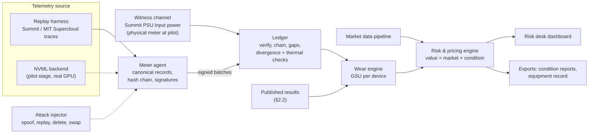

# Chirayu: Implementation Plan

**Chirayu** (चिरायु, "long-lived") is a pricing, risk and financing desk for GPU operating leases written out of GIFT IFSC. It prices leases, marks every leased GPU each month, simulates lease-end losses, hedges market risk and sizes funding tranches. All of this rests on per-GPU condition data that the lessee cannot quietly edit.

This document is the build plan for the GIFT FutureLab Grand Challenge 2026–27 finale (22 Dec 2026, IIT Gandhinagar).

> **Constraint: we have no GPU access.** The plan is built entirely on public datacenter telemetry and published research results. The good news is that it ends up stronger than a single-GPU demo would have been.
>
> - We validate tamper detection on **thousands of real Summit supercomputer nodes**, which carry an independent power-supply reading next to every GPU's self-reported power. That is our "witness" channel, already measured.
> - We build **lessee workload profiles** from real deep-learning job traces (MIT Supercloud).
> - We calibrate **wear and failure** on two real fleets with opposite cooling regimes (Titan, air-cooled; Summit, liquid-cooled).
> - We anchor **modern H100/A100 failure rates** to published results from NCSA Delta, Meta's research clusters and the Llama 3 training report.
>
> The meter agent is still built as deployable code, but it is tested against replayed telemetry instead of a live GPU. It runs on a real GPU at the pilot stage.

---

## 0. Key dates

| Date | Event | What must exist |
| --- | --- | --- |
| 25 Nov 2026 | First shortlist | Application submitted |
| 30 Nov 2026 | First mentoring interaction | M0 done: data downloaded and profiled, replay harness, GSU v0 on real traces, rate card v0, mentor questions (§13) |
| 4 Dec 2026 | Final shortlist | M1 in progress: ledger + tamper detection on Summit data, Monte Carlo v1 |
| 19 Dec 2026 | Feature freeze | M3 done; only bug fixes after this |
| 20–21 Dec 2026 | Rehearsals | Two timed full runs; backup video of every demo moment |
| 22 Dec 2026 | Grand Finale | Four demo moments (§11) |

---

## 1. Scope

### 1.1 Finale deliverables

1. **Risk desk dashboard**, covering a book of 500 GPU leases across three Indian AI-cloud lessees. Each lessee's operating profile is built from real job traces. It shows marks, LTV, expected loss, tail loss, tranche sizing and hedge ratio.
2. **Live lease pricer:** the same GPU-hours under two real workload profiles give two different rents. A flat worst-case lease is shown beside them.
3. **Value-of-data analysis:** senior tranche size and funding saving (bps) with versus without condition data.
4. **Trust layer validated on real fleet data:**
   - signed, hash-chained telemetry through the ledger;
   - tamper detection evaluated on real Summit nodes, with detection rate, false alarms per node-day and detection delay;
   - a live replay where we inject a spoof and watch the alert fire.
5. **Wear model** (GPU Stress Unit, GSU) with parameters taken from published results and calibrated on two public fleet datasets, reported with sensitivity bands.
6. **Market data pipeline:** daily scrape of public GPU rental prices, forming an India rental curve and its basis against public US index points.

### 1.2 Non-goals for the finale

- Running the meter on a live datacenter GPU. That happens at the pilot.
- Real lessor data or real leases. The book is generated, but its profiles come from real traces, and we say so.
- Hardware attestation on confidential-computing GPUs. It is designed and documented, not demonstrated.
- Production security hardening, remote control of GPUs, retail investment advice, regulatory filings.

---

## 2. Data and evidence base

### 2.1 Public datasets we use

| Dataset | What it contains | What we use it for | Access |
| --- | --- | --- | --- |
| **OLCF Summit power and thermal data** (Shin et al., SC21; DOI 10.13139/OLCF/1861393) | 27,756 V100 GPUs. Per-component power and temperature, originally 1 Hz, released as 10 s and 1 min aggregates over five month-long segments. Node input power from the power supplies. XID error log | **Witness validation:** node PSU input power is an independent channel next to self-reported GPU power. **Failure modelling** with real temperature covariates | Globus via the DOI page; companion code at `github.com/at-aaims/summit_power_and_thermal_data` |
| **ClusterWise** (Summit-derived, Hugging Face, CC BY 4.0) | 36 fields: GPU core and HBM temperature for 6 GPUs per node, per-GPU power, CPU power, PSU input power, XID code and a failure label, job IDs; 240 GB Parquet | Same as above, in an easier format: stream only the columns and nodes we need | `load_dataset("MachaParfait/ClusterWise", streaming=True)` or Polars over selected Parquet files |
| **MIT Supercloud dataset** (Samsi et al., HPEC 2021) | V100 GPU time series at 100 ms (utilization, memory, temperature, power) for many jobs, including a labelled subset of 3,430 deep-learning jobs | **Lessee profiles:** real training and inference behaviour turned into wear distributions | `aws s3 cp s3://mit-supercloud-dataset/datacenter-challenge/202201/ … --no-sign-request` (labelled subset first) |
| **ORNL Titan GPU lifetimes** (Ostrouchov et al., SC20; DOI 10.13139/ORNLNCCS/1657202) | About 100,000 GPU-years of K20X lifetimes with serials, cabinet positions and failure types | **Hot-regime calibration:** failure hazard vs. position, which the authors tie to heat dissipation | `github.com/olcf/TitanGPULife` |

### 2.2 Results we take directly from papers

These are used as anchors, not re-derived. Every one appears with its citation on the slide or in the notebook that uses it.

| Result | Source | Where it enters the model |
| --- | --- | --- |
| Titan GPU failure hazard strongly correlated with heat dissipation (cooling-air path and position) and with job scheduling | Ostrouchov et al., SC20 | Temperature acceleration in the **hot / air-cooled** regime |
| Summit (liquid-cooled): most GPUs stayed below 60 °C at peak, and overheating was not a significant driver of most failures. The highest temperature seen at a double-bit error was 46.1 °C. On Titan, high temperature was a major factor | Shin et al., SC21 | **Regime dependence:** thermal wear matters where GPUs run hot. This is exactly why it must be measured per lease and not assumed |
| Summit: GPU core temperature rose near-linearly with GPU power in a 4,608-node job; spread ~62 W power, ~15.8 °C temperature | Shin et al., SC21 | **Thermal consistency check** in the tamper detector |
| Summit per-node power sums differ from switchboard meters by ~11% on average but oscillate in phase | Shin et al., SC21 | Witness calibration uses a fitted offset and gain, not raw equality |
| NCSA Delta: H100 has 3.2× lower per-GPU MTBE than A100 for uncorrectable ECC memory errors; recovery mechanisms such as row remapping mitigated 92% of uncorrectable ECC errors on H100 | Cui et al., arXiv 2503.11901 | **Memory-error term** of the GSU; H100 vs. A100 baseline hazard |
| Meta RSC-1 vs. RSC-2 (A100): 6.50 vs. 2.34 failures per 1,000 node-days. RSC-1 GPUs swapped at ~3× the rate; the authors suggest heavier workloads may be the cause | Kokolis et al., HPCA 2025 | **Workload dependence** of failure/swap rates (stated as the authors' hypothesis); baseline node failure rate |
| Llama 3 pre-training snapshot: 419 unexpected interruptions in 54 days on 16,384 H100s, of which 148 faulty GPU and 72 HBM3 | Meta Llama 3 report (via press coverage) | Upper bound on H100 annualized interruption rate. The source counts interruptions, not card replacements |
| H100 resale value depends on condition as a first-order driver | Silicon Data H100 market analysis | Condition factor C(g) exists and is material |
| Resellers apply a 15–25% haircut for an H100 with ~20k hours | Reseller buyback guidance | Calibrating λ in C(g) = e^(−λg) |

---

## 3. Architecture



**Data flow.** The replay harness feeds real telemetry rows to the meter agent exactly as NVML would. The agent signs them. The witness channel carries the same node's independently measured PSU power. The ledger verifies both and runs the detectors. The wear engine produces stress units per device. The risk engine turns stress units and market data into every financial number.

---

## 4. Repository layout

```
chirayu/
├── IMPLEMENTATION PLAN.md
├── README.md
├── pyproject.toml              # Python 3.11+
├── configs/
│   ├── wear_params.yaml        # parameters + ranges + source citation per parameter
│   ├── risk_params.yaml
│   └── lessees.yaml            # lessee archetypes → MIT Supercloud job clusters
├── data/
│   ├── fetch_summit.py         # selected nodes/columns from ClusterWise or OLCF
│   ├── fetch_supercloud.py     # labelled subset from S3
│   ├── fetch_titan.py
│   └── README.md               # licences, citations, what we downloaded
├── agent/
│   ├── backends/
│   │   ├── nvml.py             # real NVML (pilot)
│   │   └── replay.py           # dataset rows exposed through the same interface
│   ├── sampler.py
│   ├── chain.py                # canonical JSON, hash chain, ed25519
│   ├── attest.py               # design + stub; real binding at pilot
│   └── uploader.py
├── witness/
│   ├── replay_witness.py       # Summit PSU input power as signed witness stream
│   └── HARDWARE.md             # physical witness design for the pilot
├── attacks/
│   └── inject.py               # spoof power/temp, delete, replay, swap identity
├── ledger/
│   ├── app.py                  # FastAPI
│   ├── models.py
│   ├── verify.py
│   ├── divergence.py           # PSU-vs-reported regression + CUSUM
│   ├── thermal.py              # power→temperature consistency model
│   └── merkle.py
├── eval/
│   └── tamper_eval.py          # ROC, false alarms per node-day, detection delay
├── wear/
│   ├── gsu.py
│   ├── rainflow_cycles.py
│   ├── profiles.ipynb          # MIT Supercloud → lessee archetypes
│   ├── calibrate_summit.ipynb  # Cox model with real temperature covariates
│   ├── calibrate_titan.ipynb   # hot-regime hazard vs position
│   └── sensitivity.py
├── market/
│   ├── scrapers/
│   ├── normalize.py
│   ├── index.py
│   └── store.py
├── risk/
│   ├── residual.py
│   ├── pricing.py
│   ├── reserves.py
│   ├── montecarlo.py
│   ├── tranching.py
│   ├── hedge.py
│   ├── insurance.py
│   ├── optimizer.py            # power-cap trade-off from published/measured curves
│   └── book.py
├── api/
├── web/                        # React + Vite dashboard
├── notebooks/
├── tests/
└── .github/workflows/
    ├── ci.yml
    └── scrape.yml
```

---

## 5. Tech stack and compute

| Layer | Choice |
| --- | --- |
| Language | Python 3.11+ (agent, ledger, models); TypeScript (dashboard) |
| Data | Polars + DuckDB over Parquet; Hugging Face `datasets` in streaming mode |
| Crypto | `pynacl` (Ed25519), SHA-256 |
| Ledger | FastAPI + SQLAlchemy; SQLite for development, Postgres for the demo |
| Wear and statistics | NumPy, SciPy, `rainflow`, `lifelines` (Cox PH), `scikit-learn` (clustering profiles, ROC) |
| Risk engine | NumPy (vectorised Monte Carlo); JAX only if needed |
| Market data | `httpx`, `selectolax`, DuckDB |
| Dashboard | React + Vite + Recharts/Plotly |
| CI | GitHub Actions (tests on push; daily scrape cron) |

**Compute: no GPU needed.**

- Everything runs on laptops.
- For the large datasets, use a free Kaggle or Colab CPU session, or the IITGN CPU cluster, to stream and filter. Keep only the reduced Parquet extracts in the repo or on a shared drive: target < 5 GB total.
  - **Summit:** 200–500 nodes × 1 month at 10 s, chosen at random and stratified by cabinet.
  - **MIT Supercloud:** the labelled subset first, more if time allows.

---

## 6. Components

"Owner A" means the data and trust layer; "Owner B" means the financial model. Assign names at kickoff.

### 6.1 Data fetch and profiling (`data/`, Owner A, M0)

- **Summit / ClusterWise.** Stream these columns: `timestamp, hostname, gpu{0..5}_core_temp, gpu{0..5}_mem_temp, p{0,1}_gpu{0..2}_power, p{0,1}_power, ps{0,1}_input_power, xid, label, allocation_id`. Sample nodes at random, stratified by cabinet (hostname encodes position). Write one Parquet file per node per month. Record the exact files and row counts in `data/README.md`.
- **MIT Supercloud.** Download the labelled GPU subset, then resample the 100 ms series to 1 s (mean for power and utilization, max for temperature).
- **Titan.** Clone `olcf/TitanGPULife` and use its cleaned per-GPU summary file.
- **Profiling notebook** for each dataset: missingness, sampling gaps, value ranges, and the known caveats from §2.2 (for example, missing Summit temperature periods in spring/early summer 2020).

**Acceptance.** Reduced datasets are reproducible from scripts in a single command. A data card lists each dataset's licence and citation.

### 6.2 Meter agent (`agent/`, Owner A)

**Purpose.** Produce a signed, gap-evident, per-second record of each GPU's thermal, electrical and error state. In the finale it is fed by `ReplayBackend`; at the pilot by `NvmlBackend`. Both implement the same interface:

```python
class TelemetryBackend(Protocol):
    def devices(self) -> list[DeviceInfo]: ...        # uuid/serial (replay: hostname+slot)
    def sample(self, dev: DeviceInfo) -> Sample: ...  # temp_core, temp_mem, power, energy, ecc, xid, ...
```

- **`ReplayBackend`** walks a Summit or Supercloud Parquet file at the original cadence, or accelerated (e.g. 60× for the demo). Fields the dataset lacks are `null`, never `0`.
- **`NvmlBackend`** maps to `nvmlDeviceGetTemperature`, `nvmlDeviceGetPowerUsage`, `nvmlDeviceGetTotalEnergyConsumption`, `nvmlDeviceGetTotalEccErrors`, `nvmlDeviceGetRemappedRows`, `nvmlDeviceGetFieldValues` (HBM temperature, NVLink CRC) and XID events. It is unit-tested with a mocked `pynvml`.

**Record and chain** (canonical JSON, Ed25519 over everything except `sig`):

```json
{
  "v": 1,
  "device": {"id": "summit:a01n03:gpu2", "attest_ref": null},
  "seq": 184223,
  "t": "2020-08-14T09:31:10Z",
  "nonce": "ledger-issued, rotates every 60 s",
  "s": {"temp_core": 41.0, "temp_mem": 44.0, "power_w": 212.4, "xid": null},
  "prev": "sha256(prev record)",
  "sig": "ed25519(...)"
}
```

Records are batched every 10 s and buffered locally when offline. Ledger nonces prevent pre-computed or replayed logs.

**Attestation (`attest.py`).** Document the pilot design: bind the agent key to an NVIDIA attestation report on confidential-computing-capable H100s. Ship it as a stub with tests of the binding logic. Say plainly on the slide that it is not demonstrated.

**Acceptance.** Replaying 24 h of one Summit node produces a chain that verifies 100%. Each single-field edit, a deletion or a replayed batch is detected in tests. Throughput ≥ 10,000 records/s on a laptop, enough for accelerated demo replay.

### 6.3 Witness channel (`witness/`, Owner A)

**Finale: real data.** Summit's `ps0_input_power + ps1_input_power` is the node's AC input power, measured by the power supplies. The GPU and CPU power fields come from on-chip controllers (§2.2). The two are separate measurement paths, exactly the separation the physical witness provides at the pilot. `replay_witness.py` signs the PSU stream with its own witness key, so the ledger treats it as an independent source.

**Pilot: physical witness.** `HARDWARE.md` keeps the design: ESP32-S3 + PZEM-004T v3 + CT clamp in a sealed enclosure with a tamper switch, signing readings with its own key. It also lists the safety rule: CT clamp only on lab-checked wiring.

**Optional stage prop (only if time allows, ~₹2–3k).** A metering smart plug under any laptop, with a small agent reading CPU package power (Linux RAPL). It shows the same divergence check physically on stage: "same protocol, different processor". This is a stretch goal, not on the critical path.

### 6.4 Ledger and detectors (`ledger/`, Owner A)

Tables, endpoints, nonces, gap tracking and hourly Merkle roots are as in a standard append-only log:

- **Tables:** `devices`, `leases`, `telemetry`, `witness`, `gaps`, `alerts`, `merkle_roots`, `gsu_monthly`.
- **Endpoints:** `POST /v1/nonce`, `POST /v1/telemetry/batch`, `POST /v1/witness/batch`, `GET /v1/devices/{id}/logbook`, `GET /v1/alerts`, `GET /v1/roots/{hour}`.

**Detector 1: power divergence (`divergence.py`).**

1. Per node, fit `P_psu(t) = α + β·(ΣP_gpu(t) + ΣP_cpu(t)) + ε(t)` on a clean calibration window of 24 h. α covers fans, memory, network and conversion loss; β ≥ 1 absorbs PSU efficiency.
2. Online residual `e(t)`, normalised by the calibration σ. Run a two-sided CUSUM on the normalised residual, with threshold `h` chosen on held-out clean data for a target false-alarm rate.
3. Optional refinement: a small gradient-boosted model of `P_psu` on lagged features, if the linear model's residuals are too wide.

**Detector 2: thermal consistency (`thermal.py`).** Per GPU, fit a first-order model `T(t+Δ) = T(t) + (Δ/τ)·(T_amb + R·P(t) − T(t))` on clean data. The near-linear power→temperature relation reported for Summit (§2.2) is the justification. Faking power without matching temperature, or the reverse, shows as a residual.

**Detector 3: integrity.** Chain breaks, gaps, nonce mismatch, identity change.

**Alert types:** `POWER_DIVERGENCE`, `THERMAL_INCONSISTENT`, `CHAIN_BREAK`, `GAP`, `IDENTITY_CHANGE`, `WITNESS_SILENT`.

### 6.5 Attack injection and evaluation (`attacks/`, `eval/`, Owner A)

This is the strongest technical result in the project: tamper detection measured on real fleet data, not on one staged machine.

**Attacks injected into replayed Summit streams:**

| Attack | Injection |
| --- | --- |
| Under-report load | Multiply reported GPU power by k ∈ {0.9, 0.8, 0.6} from a random start time |
| Under-report heat | Subtract d ∈ {3, 5, 10} °C from reported core and HBM temperature |
| Consistent fake | Scale power and adjust temperature through the fitted thermal model (the hardest case) |
| Drop data | Delete random 10–60 min windows |
| Replay | Re-send an earlier day's batch |
| Swap | Change the device identity mid-stream, or splice in another node's trace |

**Metrics, per attack and severity:**

- detection rate within 1 h and within 24 h;
- median detection delay;
- false alarms per 1,000 node-days on clean data;
- ROC curve over the CUSUM threshold.

**Reported honestly:** the "consistent fake" attack shows the limit of software-only checks. It is why the physical witness matters, because the PSU channel still catches it whenever the real load differs from the faked load.

**Acceptance.**

- ≥ 200 nodes evaluated.
- Clean false-alarm rate ≤ 1 per 100 node-days at the chosen threshold.
- k = 0.8 power spoof detected in > 95% of cases within 1 h.

These targets are aims, and the measured numbers are what we report.

### 6.6 Wear engine (`wear/`, Owner B with Owner A)

**Definition.**

```
GSU = Σ_t Δt · exp[(Ea/k)(1/T_ref − 1/T_j(t))] · (P(t)/P_ref)^n      (time at temperature and power)
    + w_c · Σ_cycles (ΔT_i / ΔT_ref)^m                                (thermal cycling, rainflow-counted)
    + w_m · ΔR                                                         (memory error growth, where logged)
```

1 GSU = 1 hour at reference conditions: T_ref = 70 °C, P_ref = 70% of TDP, no cycling. Every parameter in `configs/wear_params.yaml` carries a range and a citation or the label "assumption".

**Lessee profiles (`profiles.ipynb`, MIT Supercloud).**

- Featurise each labelled job: mean, p95 and max temperature and power; utilization statistics; cycle counts from rainflow; burstiness (spectral power at short periods).
- Cluster the jobs (k-means / GMM, k = 3–5) and name the clusters by their dominant job types, e.g. steady large-model training vs. short bursty jobs.
- **Output:** for each archetype, an empirical distribution of GSU per GPU-hour. The synthetic lessees in `book.py` sample from these, so the book's behaviour comes from real jobs.

**Hazard calibration, two regimes.**

1. **Summit (`calibrate_summit.ipynb`).** Time-varying Cox model of failure events (the `label`/XID hardware categories: double-bit, off-the-bus, NVLink) with covariates:
   - rolling mean and p95 core and HBM temperature;
   - rolling power;
   - rainflow cycle count;
   - node position.

   Expect a weak temperature effect, consistent with the SC21 finding for this liquid-cooled, < 60 °C fleet. Report the coefficient and its confidence interval either way.
2. **Titan (`calibrate_titan.ipynb`).** Cox model on position covariates, which the authors link to heat dissipation. The result gives a hot-regime acceleration under a stated position-to-temperature assumption.
3. **Combine:** the published contrast between the two fleets (temperature mattered on Titan, not on Summit) becomes a regime-dependent Ea: low below ~60 °C, higher in hot, air-cooled operation. Report the range, not a single number.

**H100/B200 baseline hazard.** Scale the baseline from the published anchors in §2.2: the Llama 3 interruption counts as an upper bound, and Delta's H100 vs. A100 memory MTBE ratio and Meta's node failure rates. The wear engine shifts hazard relative to that baseline; it does not invent absolute failure rates.

**Sensitivity (`sensitivity.py`).** Sweep all parameters across their ranges. The claim we defend is that the steady and bursty profiles rank the same way across ≥ 95% of the parameter space. That claim is checkable, and it is all the pricing needs.

**Acceptance.**

- Reference trace gives 1.00 GSU/h.
- Hotter and more-cycled traces give more GSU (unit tests).
- Profiles notebook produces ≥ 3 archetypes with distinct GSU distributions.
- Both calibration notebooks run end to end and print their coefficient tables.

### 6.7 Market data pipeline (`market/`, Owner B)

As before:

- Daily scrape of public GPU price pages and APIs: Indian clouds (e.g. E2E Networks, Yotta) and global ones (e.g. RunPod, Lambda, Vast.ai).
- Manually recorded public index points from Silicon Data and Ornn, with dates.
- A curated CSV of secondary-market listings.
- Rules: respect robots.txt and terms; one module per provider; raw responses cached.
- Normalise to USD per GPU-hour by SKU, term and region; INR at the RBI reference rate of the day.
- The Chirayu India rental index is the daily median per SKU; basis is India minus US.
- GitHub Actions cron commits Parquet snapshots daily.

**Acceptance.** ≥ 5 providers scraped daily for ≥ 14 consecutive days before the finale.

### 6.8 Risk engine (`risk/`, Owner B)

The finance core is unchanged. It is all pure, vectorised and driven by config.

- **Residual model:**
  - `M(a, s)` by rental DCF on the regime-switching rental path.
  - `C(g) = e^(−λg)`, with λ from reseller haircut vs. hours, mapped to GSU through the profile archetypes.
  - Failure probability `p_f(g)` from the calibrated hazard on the H100 baseline.
  - `E[V_T] = M_T·C(g_T)·(1 − p_f) + p_f·S`.
- **Pricing:**
  - Reserve rate `r = −(1/(1+y)^T)·∂E[V_T]/∂g`.
  - Base rent B solves `K = Σ(B + r·E[GSU_m])/(1+y)^m + E[V_T]/(1+y)^T`.
  - Indexed variant `B_m = B·I_m/I_0`.
  - Output: B, r, effective rent per profile, and the flat worst-case comparison.
- **Monte Carlo:** 500 leases × 20,000 paths in under 10 s.
  - 2-state Markov-switching log rental index with launch jumps.
  - Wear drawn from the archetype distributions.
  - Failures from the hazard.
  - Lessee default through a one-factor Gaussian copula linked to the market regime.
  - Outputs: EL, VaR99, CVaR99 and the full loss array.
- **Tranching:** quantile attachment points for a configurable, labelled-illustrative target exceedance probability.
  - **Value of data:** the same simulation with per-device GSU known vs. drawn from a wide prior.
  - `Saving ≈ ΔA_s·N·(s_mezz − s_senior)·D`.
- **Hedge:** minimum-variance `h* = ρσ_V/σ_F` of the India curve against public US index points, and basis share `1 − ρ²`, with a bootstrap interval. It is labelled preliminary when US points are sparse.
- **Insurance:** premium = `(1+θ)·E[(G − V_T)⁺]/(1+y)^T`, with and without data.
- **Lessee optimizer:** minimise `c_e·E(p) + r·GSU(p) − v·Throughput(p)` over power cap p. Our GSU model supplies the wear side.
  - The effect of caps on GPU power and temperature comes from published power-capping results on MIT Supercloud V100s (Zhao et al., "Sustainable Supercomputing for AI: GPU Power Capping at HPC Scale").
  - The throughput penalty per cap level is taken from figures reported in the cited power-capping literature. Where no figure fits, it is a labelled assumption with a range.
- **Book:** 500 leases, three lessees mapped to archetypes, H100/B200 mix, 24/36-month terms, seeded.

**Acceptance.**

- Pricing round-trip returns K.
- MC expected loss within ±2% between 20k and 100k paths.
- Tranching matches a hand-checked case.
- Value of data has the expected sign, with a written sanity check.

### 6.9 Dashboard and exports (shared)

**Pages:**

1. Book
2. Lease pricer
3. Loss lab
4. Structuring
5. Hedge
6. Device logbook: replayed Summit GPU with the witness overlay and live alerts
7. Tamper evaluation: ROC curves, false-alarm and delay tables from §6.5

**Exports:** a condition report per device, and the identified-equipment record (lessor, lessee, device ID, SKU, site, witness ID, lease ID and dates). Confirm the field list with mentors.

**Acceptance.** All pages work offline from one laptop with seeded data. Replay drives the logbook at ≥ 1 Hz.

---

## 7. Data contracts

| Contract | Producer → consumer | Format |
| --- | --- | --- |
| Telemetry record | agent → ledger | canonical JSON (§6.2), versioned by `v` |
| Witness record | witness → ledger | canonical JSON, own key |
| Reduced datasets | `data/` → everyone | Parquet with a schema file and data card |
| Profile archetypes | wear → risk | Parquet: `archetype, gsu_per_hr` samples |
| Hazard parameters | wear → risk | YAML with coefficients, CIs, source |
| Monthly GSU | wear → risk | Parquet: `device_id, month, gsu, gsu_lo, gsu_hi` |
| Market series | market → risk | Parquet: `date, sku, provider, term, region, usd_per_gpu_hr` |
| Risk outputs | risk → api | Parquet/JSON with `run_id`, config hash, seed |

Every number on a slide traces to a `run_id`, a config hash and the datasets or papers it came from.

---

## 8. Milestones and timeline

| Milestone | Dates | Owner A (data and trust) | Owner B (finance) | Exit criteria |
| --- | --- | --- | --- | --- |
| **M0 Data foundation** | 26–30 Nov | Fetch scripts; reduced Summit extract (≥ 200 nodes × 1 month) and MIT Supercloud labelled subset; profiling notebooks; replay backend; chain + signatures | GSU v0 on real Supercloud traces; first archetype clustering; `residual.py` + `pricing.py` v0; scraper v0 (3 providers) | **30 Nov:** rate card for two real-trace profiles; one Summit node replayed through the signed chain; mentor questions |
| **M1 Detection + simulation** | 1–7 Dec | Ledger; witness stream from PSU power; divergence detector; attack injector; first ROC on 50 nodes | Synthetic book from archetypes; Monte Carlo v1; scraper to 5+ providers with cron | **4 Dec:** k = 0.8 spoof caught on real data; EL on 500 leases |
| **M2 Evidence depth** | 8–14 Dec | Thermal-consistency detector; full evaluation on ≥ 200 nodes; false-alarm tuning | Summit and Titan hazard notebooks; regime-dependent Ea; H100 baseline from §2.2; tranching + value of data; hedge; insurance; sensitivity | Value-of-data number computed; evaluation tables final; parameter table with citations |
| **M3 Product** | 15–19 Dec | Device logbook replay page; tamper evaluation page; exports | Optimizer from published power-cap results; cache heavy runs; freeze parameters | All 7 pages; demo script end to end twice; **feature freeze 19 Dec** |
| **M4 Rehearsal** | 20–21 Dec | Backup videos (moments 3–4) | Backup videos (moments 1–2); slide figures | Two timed rehearsals; Q&A drill on §12 |
| **Finale** | 22 Dec | Runs replay + detection | Runs dashboard + numbers | — |

**Daily rhythm:** a 10-minute sync with one line each on done / next / blocked. Merge to `main` only through PRs with green CI.

---

## 9. Infrastructure and access

| Need | Plan | Fallback |
| --- | --- | --- |
| Summit telemetry | Stream ClusterWise from Hugging Face; filter on Kaggle/Colab CPU | OLCF Dataset A (58 or 100 hosts, 10 s) via Globus |
| MIT Supercloud traces | Labelled subset from the public S3 bucket | Labelled data packaged for the MIT workload challenge |
| Titan lifetimes | GitHub `olcf/TitanGPULife` | OSTI DOI page |
| Storage | Reduced Parquet extracts < 5 GB on a shared drive; only small samples committed | — |
| Demo machine | One laptop running everything (Docker Compose or plain Python) | Backup videos + screenshot deck |
| Budget | ₹0 required; optional smart plug ₹2–3k for the stage prop | — |

---

## 10. Testing and validation

| Level | What | Tool |
| --- | --- | --- |
| Unit | Canonical JSON, signatures, chain, Merkle; GSU reference cases; pricing round-trip; tranching example | `pytest` |
| Property | Any single-field mutation breaks verification; GSU monotonic in temperature and cycle amplitude | `hypothesis` |
| Integration | Replay → agent → ledger → wear → risk on a fixed 24 h Summit slice; outputs match golden files | `pytest` + fixtures |
| Detection evaluation | §6.5 on held-out nodes (calibrate on one set of nodes, evaluate on another) | `eval/tamper_eval.py` |
| Statistical | MC convergence; sensitivity ranking stability; hazard model CIs and proportional-hazards checks | notebooks with asserted thresholds |
| Demo | Full script on a clean machine, twice | checklist in `docs/demo.md` |

---

## 11. Finale demo script (about 7 minutes inside the pitch)

1. **The book (90 s).** 500 leases whose lessees behave like real deep-learning jobs (MIT Supercloud archetypes). Marks, LTV, EL, VaR on one screen.
2. **Price a lease live (90 s).** Same GPU-hours, two real archetypes, two rents, plus the flat worst-case lease. "Careful lessees pay less; the lessor is still covered."
3. **What the data is worth (90 s).** Tranches with vs. without condition data, giving the funding saving in basis points.
4. **Why you can believe it (2 min).**
   - Replay a real Summit node: GPU-reported power and temperature with the independent PSU input power overlaid.
   - Inject a 20% power under-report live; `POWER_DIVERGENCE` fires and the mark is flagged.
   - Cut to the evaluation page: the same check across 200+ real nodes, with detection rate, false alarms per node-day and the ROC.
   - Close: "The lessee controls the server. It does not control the power supply."

**Lines to have ready:**

- "Why no live GPU?" → "We validated on real data from 27,756-GPU Summit instead of one GPU on a table. The agent's NVML backend is built and goes live at the pilot."
- "Isn't V100 data old?" → "The detection logic is about physics: power in equals heat out. Failure baselines for H100 come from published H100 studies."

---

## 12. Risks and mitigations

| Risk | Likelihood | Impact | Mitigation |
| --- | --- | --- | --- |
| Dataset size or download friction (240 GB / multi-TB) | Medium | High | Stream only needed columns; small node sample; start the downloads on day 1 |
| Summit PSU power includes non-GPU load and has an ~11% offset vs. switchboard | Certain | Medium | Regression with offset and gain; CPU power as a covariate; evaluate on residuals, not raw equality |
| Weak temperature effect on Summit makes thermal wear look small | High | Medium | That is the published finding, so present it: wear is regime-dependent; Titan anchors the hot regime; pricing only needs the ranking |
| V100/K20X data vs. H100/B200 leases | Certain | Medium | Use old fleets only for relative effects and detection; absolute H100 rates from Delta, Meta and Llama 3 |
| "No live hardware" challenged | High | Medium | Real fleet validation is the stronger evidence; optional smart-plug prop; NVML backend shown in code |
| Too few public US index points for the hedge | High | Low | Present as method + preliminary estimate with a confidence interval |
| "Synthetic book" challenged | Certain | Medium | Say it first; profiles are real; ask the jury for a pilot lessor |
| Scope creep | High | High | Feature freeze 19 Dec |
| Demo-day failure | Medium | High | Everything local; backup videos; screenshot deck |

---

## 13. Open questions for mentors (30 Nov)

1. Would a GIFT lessor or IFSC Banking Unit accept a per-stress-unit reserve, or prefer a fixed reserve with a condition-based true-up at return?
2. Which fields should an "identified equipment" record carry for IFSCA's GPU leasing framework?
3. Would Chirayu as a service to lessors fall under IFSCA's TechFin and Ancillary Services regulations?
4. Is any lessor, IBU or insurer in the GIFT ecosystem open to a pilot with real GPUs after the finale? This also answers the "no live hardware" gap.
5. Which target exceedance probabilities and spread assumptions would a GIFT banker find credible for the tranching analysis?
6. Does anyone know of an existing per-use GPU wear pricing product? (This tests the novelty claim.)
7. Can IITGN or GIFT arrange even a few hours on a datacenter GPU before 19 Dec? If yes, it adds a live NVML run as a bonus; it is not required.

---

## 14. Definition of done (finale)

- [ ] All four demo moments run from one laptop, twice in a row, with no manual fixes
- [ ] Tamper evaluation on ≥ 200 real Summit nodes, with detection rate, delay, false alarms and ROC reported
- [ ] Lessee archetypes built from MIT Supercloud traces; GSU distributions per archetype
- [ ] Summit and Titan hazard notebooks run end to end; parameter table with a citation per value
- [ ] Every number shown traces to a `run_id`, config hash and source dataset or paper
- [ ] ≥ 14 days of daily market data
- [ ] README states what is real data, what is published results, what is synthetic and what is assumed
- [ ] Backup videos and screenshot deck on two devices

---

## 15. After the finale

Pilot with one lessor and one Indian GPU cloud on 8–64 GPUs: the NVML backend live, a physical witness and attestation binding. Then publish the GSU spec as an open standard, with the agent open source and the pricing engine proprietary. Further out: an encumbrance registry keyed to GPU hardware identity.

---

## References

1. Shin, W., Oles, V., Karimi, A. M., Ellis, J. A., Wang, F. "Revealing Power, Energy and Thermal Dynamics of a 200PF Pre-Exascale Supercomputer." SC21. https://www.osti.gov/servlets/purl/1833956
2. Shin, W. et al. "Long Term Per-Component Power and Thermal Measurements of the OLCF Summit System." Dataset, DOI 10.13139/OLCF/1861393. Companion code: https://github.com/at-aaims/summit_power_and_thermal_data
3. ClusterWise (Summit-derived dataset), CC BY 4.0. https://huggingface.co/datasets/MachaParfait/ClusterWise
4. Samsi, S. et al. "The MIT Supercloud Dataset." IEEE HPEC 2021. https://arxiv.org/abs/2108.02037. Data: https://dcc.mit.edu/data
5. Ostrouchov, G. et al. "GPU Lifetimes on Titan Supercomputer: Survival Analysis and Reliability." SC20. Data: DOI 10.13139/ORNLNCCS/1657202; https://github.com/olcf/TitanGPULife
6. Cui, S. et al. "Characterizing GPU Resilience and Impact on AI/HPC Systems" (also titled "Story of Two GPUs"). arXiv 2503.11901. https://arxiv.org/abs/2503.11901
7. Kokolis, A. et al. "Revisiting Reliability in Large-Scale Machine Learning Research Clusters." HPCA 2025. https://arxiv.org/abs/2410.21680
8. Zhao, D. et al. "Sustainable Supercomputing for AI: GPU Power Capping at HPC Scale." arXiv 2402.18593. https://arxiv.org/abs/2402.18593
9. Meta Llama 3 training reliability figures, as reported by Tom's Hardware. https://www.tomshardware.com/pc-components/gpus/datacenter-gpu-service-life-can-be-surprisingly-short-only-one-to-three-years-is-expected-according-to-unnamed-google-architect
10. Silicon Data, "The Illusion of Stability: Unpacking H100 GPU Market Value Trends." https://www.silicondata.com/use-cases/h100-gpu-market-value-trends
